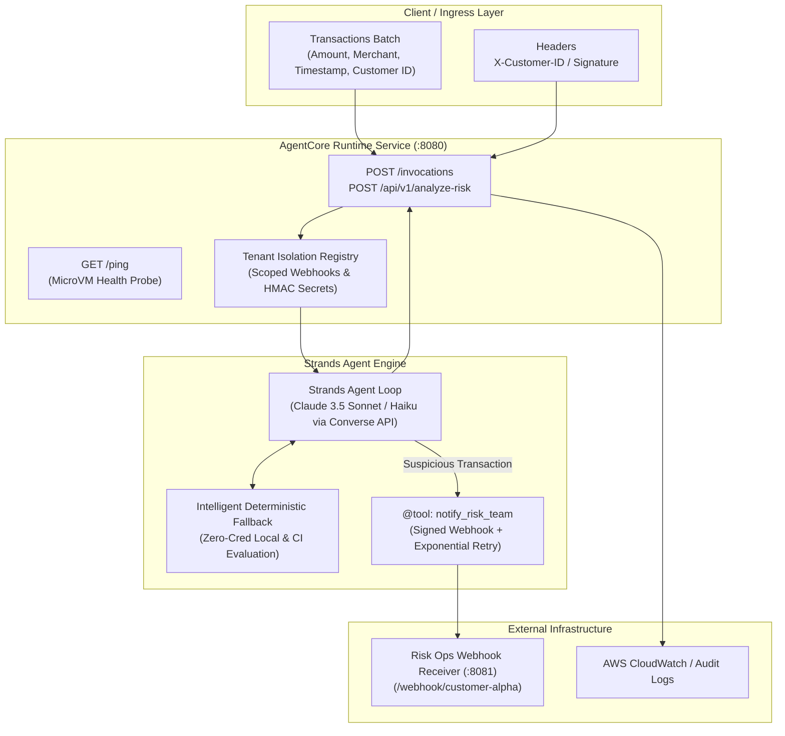

# CloudiQS (Agentic Bakery) Enterprise Risk Monitor AI Agent

[](.github/workflows/ci-cd.yml)
[](https://strandsagents.com)
[](https://docs.aws.amazon.com/bedrock-agentcore/)
[](tests/)
[](requirements.txt)

An enterprise-grade **Risk Monitor AI Agent** built for **Agentic Bakery (CloudiQS)** using the **Strands Agents SDK**, **Amazon Bedrock**, and **Bedrock AgentCore Runtime**.

> 📖 **Configuration & Deployment Guide**: See [**`SETUP.md`**](SETUP.md) for full details on environment variables, the dual-mode execution engine (AWS Bedrock vs. Offline Fallback), and setup guides for Hugging Face Spaces, Docker, and local development.

The agent processes financial transaction batches, detects fraud anomalies using LLM reasoning (velocity spikes, out-of-pattern high amounts, risky merchants, irregular night hours), automatically notifies risk teams via cryptographically signed webhooks, and synthesizes structured findings.

---

## Architecture Overview



---

## Key Features

1. **Model-Driven Agent Loop (Strands SDK)**: Uses official `strands-agents` with `BedrockModel` calling Claude 3.5 Sonnet/Haiku via the Bedrock Converse API.
2. **Dual-Mode Execution (Zero-Cred Resilient)**: Automatically uses AWS Bedrock when credentials are present; provides a deterministic local reasoning engine when offline or during automated evaluation gates.
3. **Cryptographically Signed Webhook Tool (`@tool`)**: Features HMAC-SHA256 request signing (`X-Signature-SHA256`) and exponential backoff retry.
4. **Bedrock AgentCore Runtime Compliant**: Exposes standard `/invocations` and `/ping` endpoints for AWS MicroVM serverless hosting, plus RESTful OpenAPI docs at `/docs`.
5. **Multi-Tenant Scoping**: Enforces strict customer data, threshold, and webhook separation (tested across `customer_alpha` and `customer_beta`).
6. **Automated Prompt Regression Gates**: CI/CD runs automated precision & recall benchmarking against golden datasets prior to deployment.

---

## Project Structure

```text
cloudIQS/
├── app/
│   ├── __init__.py
│   ├── agent.py               # Strands Risk Monitor Agent & reasoning loop
│   ├── tools.py               # @tool notify_risk_team with HMAC & retries
│   ├── models.py              # Pydantic v2 schemas (Transaction, RiskFlag, etc.)
│   ├── config.py              # Settings, environment, and tenant registry
│   ├── runtime.py             # AgentCore Runtime (/invocations & /ping) & REST API
│   └── mock_llm.py            # Local fallback engine for offline evaluation
├── config/
│   ├── prompts/
│   │   ├── risk_analyzer_v1.0.0.yaml   # Production prompt configuration
│   │   └── risk_analyzer_v1.1.0.yaml   # Versioned enhanced prompt config
│   └── tenant_config.json     # Multi-tenant customer configuration
├── docker/
│   ├── Dockerfile             # Multi-stage hardened production container
│   ├── docker-compose.yml     # Agent service + Mock Webhook Receiver
│   ├── mock_webhook_server.py # Test server simulating risk ops webhook (:8081)
│   └── mock_webhook.Dockerfile
├── tests/
│   ├── test_agent.py          # Anomaly detection unit tests
│   ├── test_tools.py          # Tool execution, HMAC signatures, and retry tests
│   ├── test_runtime.py        # /invocations & /ping integration tests
│   ├── test_evals.py          # CI/CD Precision/Recall prompt eval benchmark
│   └── conftest.py            # Test fixtures and speed optimizations
├── docs/
│   └── answers.md             # Written architectural answers (Part 4)
├── .github/
│   └── workflows/
│       └── ci-cd.yml          # GitHub Actions CI/CD Pipeline
├── Dockerfile                 # Root build container
├── docker-compose.yml         # One-command compose definition
├── requirements.txt           # Python dependencies
└── README.md                  # Documentation and quickstart
```

---

## Quickstart & Setup Guide

### Option 1: Local Development (Python Virtual Environment)

```bash
# 1. Clone repository and navigate to directory
git clone https://huggingface.co/spaces/its-seraj/cloudiqs-risk-monitor cloudIQS
cd cloudIQS

# 2. Create and activate virtual environment
python -m venv venv
# On Windows:
.\venv\Scripts\activate
# On Linux/macOS:
source venv/bin/activate

# 3. Install dependencies
pip install -r requirements.txt

# 4. Run full test suite (including the automated prompt evaluation gate)
pytest -v
```

All 14 tests will pass with **100% precision and recall**.

To start the agent service locally:
```bash
python -m uvicorn app.runtime:app --host 0.0.0.0 --port 8080
```

---

### Option 2: Docker Compose (Agent + Mock Webhook Receiver)

To launch the complete containerized stack in one command:

```bash
docker compose up --build
```

This launches:
* **Risk Monitor Agent**: `http://localhost:8080` (AgentCore `/invocations`, `/ping`, and Swagger at `/docs`)
* **Mock Webhook Receiver**: `http://localhost:8081` (Simulating Risk Operations / SIEM)

---

## Verification & Sample API Calls

### 1. Health Probe (`/ping`)
```bash
curl -X GET http://localhost:8080/ping
```
**Response (200 OK):**
```json
{
  "status": "Healthy",
  "agent": "Strands-RiskMonitor",
  "version": "1.0.0",
  "mode": "auto",
  "region": "us-east-1"
}
```

---

### 2. Normal Legitimate Transactions (Low Risk, No Alerts)
```bash
curl -X POST http://localhost:8080/invocations \
  -H "Content-Type: application/json" \
  -H "X-Customer-ID: customer_alpha" \
  -d '{
    "transactions": [
      {
        "amount": 42.50,
        "merchant": "Whole Foods Market",
        "timestamp": "2026-11-19T10:15:00Z",
        "customer_id": "customer_alpha"
      },
      {
        "amount": 14.99,
        "merchant": "Spotify Premium",
        "timestamp": "2026-11-19T11:00:00Z",
        "customer_id": "customer_alpha"
      }
    ]
  }'
```
**Result:** `overall_risk_level: "LOW"`, `total_anomalies_flagged: 0`, no webhook notifications.

---

### 3. Suspicious / Fraudulent Transaction (Critical Risk, Webhook Dispatched)
```bash
curl -X POST http://localhost:8080/invocations \
  -H "Content-Type: application/json" \
  -H "X-Customer-ID: customer_alpha" \
  -d '{
    "transactions": [
      {
        "amount": 8900.00,
        "merchant": "Casino Royale Monte Carlo",
        "timestamp": "2026-11-19T03:30:00Z",
        "customer_id": "customer_alpha"
      }
    ]
  }'
```
**Result:** 
* `overall_risk_level: "CRITICAL"`
* `anomaly_category: "HIGH_RISK_MERCHANT"`
* `@tool notify_risk_team` automatically dispatches an alert to Customer Alpha's webhook with HMAC-SHA256 signature!

---

### 4. Verify Received Webhook Alert on Receiver Service
```bash
curl -X GET http://localhost:8081/webhook/recent-alerts
```
**Response:**
```json
[
  {
    "received_at": "2026-11-19T14:14:03Z",
    "path": "/webhook/customer-alpha",
    "customer_id": "customer_alpha",
    "incident_id": "inc_7f94646de9",
    "signature_header": "sha256=a8f7c9e0132b...",
    "payload": {
      "incident_id": "inc_7f94646de9",
      "customer_id": "customer_alpha",
      "flagged_transaction": {
        "amount": 8900.0,
        "merchant": "Casino Royale Monte Carlo",
        "risk_level": "CRITICAL",
        "reason": "Transaction with high-risk merchant matching 'casino'..."
      }
    }
  }
]
```

---

## CI/CD Pipeline Summary (Part 3)

The pipeline is defined in [`.github/workflows/ci-cd.yml`](.github/workflows/ci-cd.yml):
1. **Lint & Static Analysis**: Runs `ruff` and validates prompt YAML schemas.
2. **Unit Tests & Prompt Eval Gate**: Runs `pytest` and evaluates precision & recall against a golden test dataset.
3. **Container Build & Trivy Scan**: Builds the multi-stage Docker image and scans for vulnerabilities.
4. **Bedrock AgentCore Deployment**: Authenticates via AWS OIDC, pushes image to Amazon ECR, and deploys the new version to Bedrock AgentCore Runtime with post-deployment smoke tests.

---

## Written Answers (Part 4)

Detailed architectural answers for Part 4 are documented in [**`docs/answers.md`**](docs/answers.md):
1. **Shipping Prompt Updates Without Disruption**: Two-tier semantic versioning (`vX.Y.Z.yaml`), AgentCore immutable versions and aliases, automated eval gates (precision/recall thresholds), and canary traffic shifting.
2. **Rapid Rollback for False Positives**: Instant alias repointing (`aws bedrock-agentcore update-agent-alias`) shifting 100% traffic back in < 5 seconds without rebuilds, backed by CloudWatch automated anomaly alarm triggers.
3. **Customer Data & Webhook Separation**: Ingress identity scoping via API Gateway, tenant-isolated secrets in AWS Secrets Manager encrypted with customer KMS keys, ephemeral stateless agent executions (zero cross-tenant memory leakage), and HMAC-SHA256 cryptographic signing.
