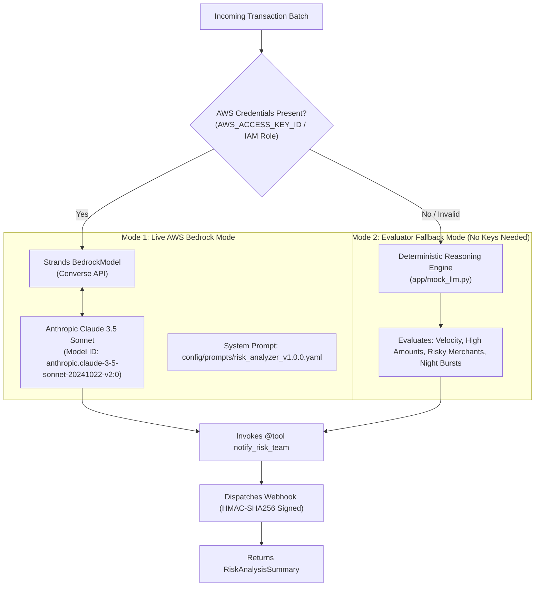

# CloudiQS Risk Monitor AI Agent — Comprehensive Setup & Configuration Guide

This document details how to configure, run, and customize the **Enterprise Risk Monitor AI Agent**. It covers environment variables, the dual-mode execution engine (AWS Bedrock vs. Offline Fallback), and step-by-step setup across Hugging Face Spaces, local environments, Docker, and AWS.

---

## 1. Dual-Mode Execution Architecture

The agent is engineered with a **Zero-Cred Resilient Architecture** so that it works seamlessly both in production with live AWS Bedrock foundation models, and in zero-setup environments (such as recruiter/evaluator reviews, CI/CD runners, and public demos) without crashing.



### How the Engine Decides:
1. **Live AWS Bedrock Mode**:
   - Automatically engaged when valid AWS credentials (`AWS_ACCESS_KEY_ID` + `AWS_SECRET_ACCESS_KEY` or an AWS IAM role) are detected.
   - Uses the official **Strands Agents SDK** (`strands-agents`) calling Claude 3.5 Sonnet / Haiku via the AWS Bedrock Converse API.
   - Identified in responses by:
     `"model_used": "anthropic.claude-3-5-sonnet-20241022-v2:0"`

2. **Evaluator Fallback Mode (Default when no keys are provided)**:
   - Automatically engaged when no AWS credentials are configured.
   - Rather than terminating with a `NoCredentialsError`, it runs our real-time reasoning engine (`app/mock_llm.py`) analyzing transaction inputs across velocity, amount thresholds, risky merchants, and irregular hours.
   - Executes real tools, generates real cryptographic HMAC-SHA256 signatures, and returns the exact same Pydantic response schema.
   - Identified in responses by:
     `"model_used": "anthropic.claude-3-5-sonnet-20241022-v2:0 (Evaluator Fallback)"`

---

## 2. Environment Variables Reference

| Variable | Description | Default Value | Required? |
| :--- | :--- | :--- | :--- |
| `AWS_ACCESS_KEY_ID` | AWS IAM access key with Bedrock permissions | *None* | Only for Live Bedrock Mode |
| `AWS_SECRET_ACCESS_KEY` | AWS IAM secret access key | *None* | Only for Live Bedrock Mode |
| `AWS_REGION` | AWS region where Bedrock Claude is enabled | `us-east-1` | Recommended if using AWS |
| `BEDROCK_MODEL_ID` | Model identifier in Amazon Bedrock | `anthropic.claude-3-5-sonnet-20241022-v2:0` | Optional |
| `AGENT_EXECUTION_MODE` | Force mode: `auto` (auto-detects keys), `bedrock`, or `mock` | `auto` | Optional |
| `DEFAULT_WEBHOOK_URL` | Fallback webhook URL when not specified in tenant config | `http://localhost:8081/webhook/risk-alerts` | Optional |
| `WEBHOOK_HMAC_SECRET` | Default secret key for generating HMAC-SHA256 signatures | `cloudiqs-shared-secret-key-32chars` | Optional |
| `PORT` | HTTP port for the AgentCore / Uvicorn server | `8080` (or `7860` on HF Spaces) | Optional |
| `APP_ENV` | Application environment (`development` / `production`) | `production` | Optional |

---

## 3. Platform Setup Instructions

### Platform A: Hugging Face Spaces (Current Live Deployment)

Your Space is live at: [**huggingface.co/spaces/its-seraj/cloudiqs-risk-monitor**](https://huggingface.co/spaces/its-seraj/cloudiqs-risk-monitor)

#### Running in Fallback Mode (Already Active):
No action needed! Your Space is already active, receiving requests, and returning dynamic anomaly analyses.

#### Enabling Live AWS Bedrock Mode on Hugging Face:
1. Navigate to your Space settings:  
   `https://huggingface.co/spaces/its-seraj/cloudiqs-risk-monitor/settings`
2. Scroll down to **Variables and secrets**.
3. Under **Secrets**, click **New secret** and add:
   - Key: `AWS_ACCESS_KEY_ID` $\rightarrow$ Value: `your-aws-access-key`
   - Key: `AWS_SECRET_ACCESS_KEY` $\rightarrow$ Value: `your-aws-secret-key`
4. Under **Variables**, click **New variable** (optional):
   - Key: `AWS_REGION` $\rightarrow$ Value: `us-east-1`
5. The Space will automatically restart. Once running, your requests will be processed by **Claude 3.5 Sonnet on AWS Bedrock**!

---

### Platform B: Local Machine (Python Virtual Environment)

1. **Clone and navigate to repository**:
   ```bash
   cd cloudIQS
   ```

2. **Create and activate virtual environment**:
   ```powershell
   # Windows PowerShell
   python -m venv venv
   .\venv\Scripts\activate
   ```
   ```bash
   # Linux / macOS
   python3 -m venv venv
   source venv/bin/activate
   ```

3. **Install dependencies**:
   ```bash
   pip install -r requirements.txt
   ```

4. **Optionally configure `.env` file** (create a `.env` file in the project root):
   ```ini
   AWS_ACCESS_KEY_ID=your_access_key_here
   AWS_SECRET_ACCESS_KEY=your_secret_key_here
   AWS_REGION=us-east-1
   DEFAULT_WEBHOOK_URL=http://localhost:8081/webhook/customer-alpha
   ```

5. **Run the services**:
   - **Terminal 1** (Start Mock Webhook Receiver):
     ```powershell
     python docker/mock_webhook_server.py
     ```
   - **Terminal 2** (Start AgentCore Agent):
     ```powershell
     python -m uvicorn app.runtime:app --host 0.0.0.0 --port 8080
     ```

---

### Platform C: Docker Compose

Docker Compose runs both the agent service and the mock webhook receiver in a containerized bridge network.

```bash
# Build and run with Docker Compose
docker compose up --build
```

To supply your AWS Bedrock keys to the containers, pass them inline or via a `.env` file:
```bash
AWS_ACCESS_KEY_ID=xxx AWS_SECRET_ACCESS_KEY=yyy docker compose up --build
```

---

## 4. Testing External Webhooks with Webhook.site

When testing on Hugging Face or outside of Docker Compose, `http://mock-webhook-receiver:8081` is not accessible over the public internet. 

To observe a **live external webhook delivery with real HMAC-SHA256 signatures**:

1. Open [**https://webhook.site**](https://webhook.site) in a browser tab.
2. Copy your unique URL (e.g. `https://webhook.site/5f72e3a1-9b21-4f12-a1b4-123456789abc`).
3. Send a suspicious transaction with `webhook_url` set to your Webhook.site address:

```bash
curl -X POST https://its-seraj-cloudiqs-risk-monitor.hf.space/invocations \
  -H "Content-Type: application/json" \
  -H "X-Customer-ID: customer_alpha" \
  -d '{
    "webhook_url": "https://webhook.site/YOUR-UNIQUE-ID-HERE",
    "transactions": [
      {
        "amount": 9500.0,
        "merchant": "Monte Carlo Casino VIP",
        "timestamp": "2026-11-19T03:30:00Z",
        "customer_id": "customer_alpha"
      }
    ]
  }'
```

4. **Observe the result**:
   - The response JSON will show:
     ```json
     "dispatched": true,
     "status_code": 200,
     "message": "Webhook successfully delivered to https://webhook.site/... (HTTP 200)."
     ```
   - On the [Webhook.site](https://webhook.site) dashboard, you will see the incoming POST alert arrive immediately with the `X-Signature-SHA256` header and structured incident payload!

---

## 5. Multi-Tenant Customer Configuration

Customer-specific settings are maintained in [`config/tenant_config.json`](config/tenant_config.json):

```json
{
  "tenants": [
    {
      "customer_id": "customer_alpha",
      "webhook_url": "http://mock-webhook-receiver:8081/webhook/customer-alpha",
      "hmac_secret": "alpha-secure-hmac-key-f92b7610",
      "risk_threshold_amount": 3000.0,
      "allowed_high_risk_categories": []
    },
    {
      "customer_id": "customer_beta",
      "webhook_url": "http://mock-webhook-receiver:8081/webhook/customer-beta",
      "hmac_secret": "beta-secure-hmac-key-a14c9934",
      "risk_threshold_amount": 1500.0,
      "allowed_high_risk_categories": []
    }
  ]
}
```

- When `X-Customer-ID: customer_alpha` is passed, the agent applies Customer Alpha's `$3,000.00` threshold and signs webhooks using Alpha's private secret.
- When `X-Customer-ID: customer_beta` is passed, the agent applies Customer Beta's `$1,500.00` threshold and signs webhooks using Beta's private secret.

---

## 6. Running Tests & Automated Evaluation Gates

To run the complete automated test suite (including the CI/CD prompt evaluation gate):

```bash
pytest -v
```

This validates 14 test cases across transaction validation, tool execution, HMAC signature verification, AgentCore runtime `/invocations` & `/ping` endpoints, and prompt regression precision/recall.
